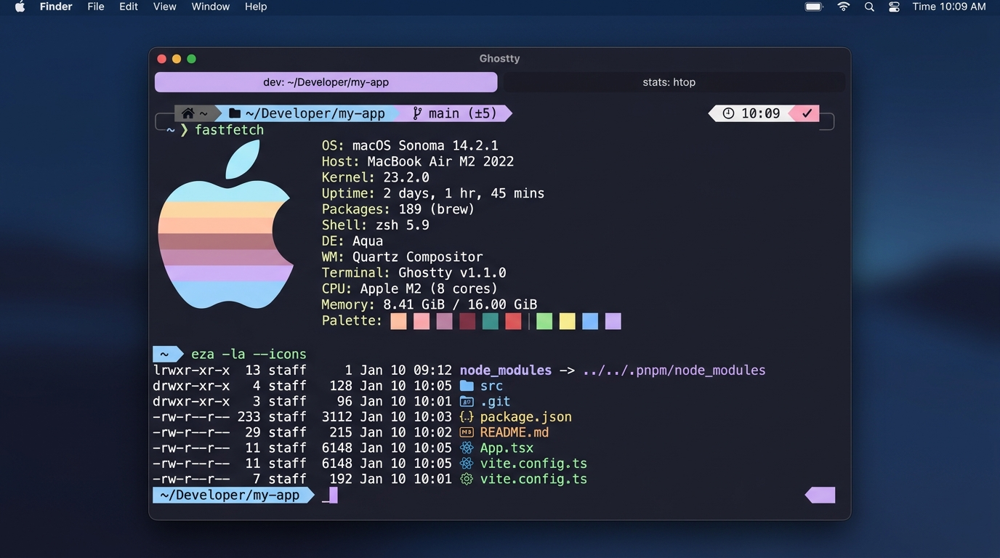
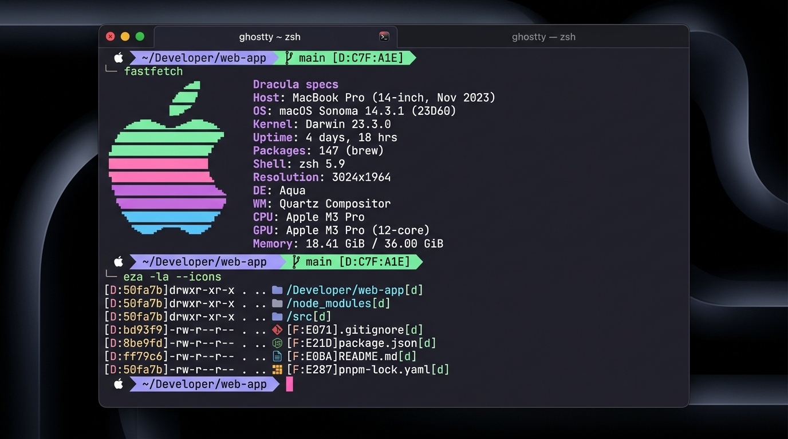
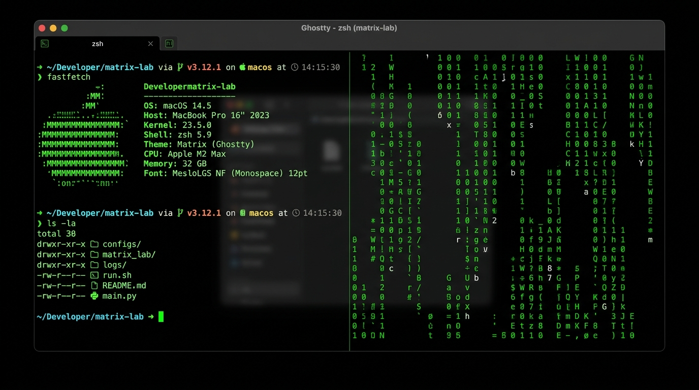

<div align="center">

# 👻 Ghostty Setup Guide

### Make your Mac terminal fast, pretty, and easy to use, one small step at a time.

_Part of [⚡ Terminal Forge](./README.md). Using iTerm2 instead? Go to the [🚀 iTerm2 Setup Guide](./ITERM2-SETUP.md)._

<br />

[✅ Before You Start](#before-you-start) • [🧱 Install](#step-4-install-oh-my-zsh) • [🎨 Make It Pretty](#step-8-change-how-ghostty-looks) • [📁 Icons](#step-9-add-folder-and-file-icons) • [📂 Jump](#step-10-jump-to-folders-with-zoxide) • [⚡ Shortcuts](#step-11-make-your-own-shortcut-commands) • [⌨️ Keys](#step-12-learn-the-keyboard-shortcuts) • [🔍 Check](#final-check) • [🛠️ Help](#troubleshooting)

</div>

---

## Read This First

This guide is written for **students and total beginners**. You don't need to know anything about the terminal.

**How to use this guide:**

1. Do the steps **in order**. Don't skip.
2. **Copy** each grey code box and **paste** it into Ghostty (`Cmd + V`), then press **Return**.
3. After each step there's a **"✅ Check"**. Run it to make sure the step worked.
4. If something goes wrong, jump to [🛠️ Help](#troubleshooting).

> [!TIP]
> Anything after a `#` in a code box is a **comment**. It's a note for you. The computer ignores it.

### Words You'll See

| Word            | Simple meaning                                                            |
| :-------------- | :------------------------------------------------------------------------ |
| **Terminal**    | The window where you type commands. Here, that's **Ghostty**.             |
| **Command**     | An instruction you type, like `ls` (list files).                          |
| **Shell / Zsh** | The "brain" inside the terminal that understands your commands.           |
| **Prompt**      | The text at the start of the line that means "I'm ready, type something". |
| **Config file** | A text file that stores settings. Change the file → change the app.       |
| **`~`**         | Short for your home folder (`/Users/your-name`).                          |
| **`~/.zshrc`**  | The settings file for your shell. You'll edit it a lot.                   |

---

<a id="before-you-start"></a>

## Before You Start

You should have already finished **Steps 1–3** of the [main README](./README.md#step-by-step-installation). Quick recap:

```bash
# Step 1 – Homebrew (the "App Store" for the terminal)
brew --version            # should print: Homebrew 4.x.x

# Step 2 – Ghostty (if not installed yet)
brew install --cask ghostty

# Step 3 – Zsh (your shell)
echo $SHELL               # should print: /bin/zsh
```

Now **open Ghostty** (press `Cmd + Space`, type **Ghostty**, press Return). Do every step below **inside Ghostty**.

> [!TIP]
> Right-click the Ghostty icon in your Dock → **Options → Keep in Dock**, so it's always one click away.

---

<a id="step-4-install-oh-my-zsh"></a>

## Step 4 · Install Oh My Zsh

**What is it?** A free add-on that makes Zsh easy to decorate with **themes** (looks) and **plugins** (ready-made shortcuts).

**1. Make a backup** of your current settings (just in case):

```bash
cp ~/.zshrc ~/.zshrc.backup 2>/dev/null || true
```

**2. Install it:**

```bash
sh -c "$(curl -fsSL https://raw.githubusercontent.com/ohmyzsh/ohmyzsh/master/tools/install.sh)"
```

If it asks _"Do you want to change your default shell to zsh?"_, type `Y` and press Return.

Your prompt will change. That's normal! 🎉

**✅ Check:**

```bash
ls ~/.oh-my-zsh
```

You should see folders called `plugins`, `themes`, and `custom`.

---

<a id="step-5-install-a-nerd-font"></a>

## Step 5 · Install a Nerd Font (for Icons)

**What is it?** A coding font with thousands of little **icons** built in (folders 📁, Git branches, Apple logo…). Without it, icons show up as empty boxes ▯.

**1. Install the font:**

```bash
brew install --cask font-meslo-lg-nerd-font
```

**2. Tell Ghostty to use it.** Open the Ghostty config file:

```bash
mkdir -p ~/.config/ghostty && nano ~/.config/ghostty/config.ghostty
```

You're now inside **nano**, a simple text editor. Add (or change) this line:

```ini
font-family = "MesloLGS Nerd Font"
```

**3. Save and close nano:**

| Press                     | What happens   |
| :------------------------ | :------------- |
| `Ctrl + O`, then `Return` | Saves the file |
| `Ctrl + X`                | Closes nano    |

**4. Reload Ghostty:** press **`Cmd + Shift + ,`** (Command + Shift + comma).

**✅ Check:**

```bash
echo -e "   "
```

You should see 4 icons: a **Git branch**, the **GitHub cat**, the **Apple logo**, and a **folder**. If you see boxes, see [Help → Icons look like boxes](#icons-look-like-boxes).

---

<a id="step-6-install-powerlevel10k"></a>

## Step 6 · Install Powerlevel10k (Pretty Prompt)

**What is it?** A theme that turns your boring prompt into a colorful one. It shows your folder, your Git branch, and more.

**1. Download it:**

```bash
git clone --depth=1 https://github.com/romkatv/powerlevel10k.git \
  "${ZSH_CUSTOM:-$HOME/.oh-my-zsh/custom}/themes/powerlevel10k"
```

**2. Turn it on.** Open your shell settings:

```bash
nano ~/.zshrc
```

Press `Ctrl + W`, type `ZSH_THEME`, and press Return to jump to that line. Change it to:

```bash
ZSH_THEME="powerlevel10k/powerlevel10k"
```

Save (`Ctrl + O`, `Return`) and close (`Ctrl + X`).

**3. Restart the shell** to start the setup wizard:

```bash
exec zsh
```

**4. Answer the questions.** The wizard shows you pictures and asks _"Does this look like a diamond?"_ etc. Just press the letter or number next to the answer you like. Pick **Unicode** when asked about characters.

> [!NOTE]
> There are no wrong answers! You can redo the wizard anytime with:
>
> ```bash
> p10k configure
> ```

**✅ Check:**

```bash
echo $ZSH_THEME
```

Should print: `powerlevel10k/powerlevel10k`

---

<a id="step-7-turn-on-plugins"></a>

## Step 7 · Turn On Plugins

**What are they?** Plugins give you free shortcuts. For example, the `git` plugin lets you type `gst` instead of `git status`.

### 7.1 Built-in Plugins

| Plugin   | What you get                                                      |
| :------- | :---------------------------------------------------------------- |
| `git`    | `gst` = `git status`, `ga` = `git add`, `gcmsg` = `git commit -m` |
| `macos`  | `ofd` = open this folder in Finder                                |
| `python` | `py` = `python3`, `pyclean` = delete `__pycache__` folders        |

### 7.2 Two Must-Have Extra Plugins

- **zsh-autosuggestions**: while you type, it shows a faded guess from your past commands. Press **→** to accept it.
- **zsh-syntax-highlighting**: your command turns **green** if it's correct and **red** if it's misspelled.

Download them:

```bash
git clone https://github.com/zsh-users/zsh-autosuggestions \
  "${ZSH_CUSTOM:-$HOME/.oh-my-zsh/custom}/plugins/zsh-autosuggestions"

git clone https://github.com/zsh-users/zsh-syntax-highlighting.git \
  "${ZSH_CUSTOM:-$HOME/.oh-my-zsh/custom}/plugins/zsh-syntax-highlighting"
```

### 7.3 Turn Them All On

```bash
nano ~/.zshrc
```

Find the line `plugins=(git)` and change it to:

```bash
plugins=(git macos python zsh-autosuggestions zsh-syntax-highlighting)
```

> [!IMPORTANT]
> Use **spaces** between names, not commas. Keep `zsh-syntax-highlighting` **last**.

Save, close, and apply:

```bash
source ~/.zshrc
```

**✅ Check:**

```bash
alias gst
```

Should print: `gst='git status'`

---

<a id="step-8-change-how-ghostty-looks"></a>

## Step 8 · Change How Ghostty Looks

All of Ghostty's looks live in **one file**. The routine is always the same:

```text
1. Open the config     →  Cmd + ,      (or: nano ~/.config/ghostty/config.ghostty)
2. Change a line       →  setting = value
3. Save                →  Cmd + S      (or in nano: Ctrl + O, Return, Ctrl + X)
4. Reload Ghostty      →  Cmd + Shift + ,
```

### 8.1 Pick a Color Theme

Ghostty has **hundreds** of themes built in. Preview them live:

```bash
ghostty +list-themes
```

- `↑` / `↓` to look through them
- `/` to search by name
- `q` to quit

When you find one you like, put it in your config:

```ini
theme = "Catppuccin Mocha"
```

**Student favorites:** `Catppuccin Mocha` · `TokyoNight` · `Dracula` · `Nord` · `Gruvbox Dark` · `Rose Pine`

#### Setup: Catppuccin Mocha Theme (Default)

Soft pastel colors on a deep slate canvas. It's gentle on the eyes and the default theme configured in this guide.



**1.** Open the config (`Cmd + ,`) and set:

```ini
theme = "Catppuccin Mocha"
```

**2.** Save and reload with `Cmd + Shift + ,`. Done! ☕

---

#### Setup: Dracula Theme

Dark purple background with pink, green, and cyan text. One of the most popular coding themes in the world.



**1.** Check that Ghostty has it:

```bash
ghostty +list-themes | grep -i dracula
```

**2.** Open the config (`Cmd + ,`) and set:

```ini
theme = "Dracula"
```

**3.** Save and reload with `Cmd + Shift + ,`. Done! 🧛

<details>
<summary><b>Make it look even more "Dracula" (optional)</b></summary>

<br />

Add these lines **under** the `theme` line to match the official Dracula colors exactly:

```ini
background = #282a36
foreground = #f8f8f2
cursor-color = #ff79c6
selection-background = #44475a
selection-foreground = #f8f8f2
background-opacity = 0.95
```

Official site: [draculatheme.com/ghostty](https://draculatheme.com/ghostty)

</details>

---

#### Setup: Matrix Theme

Black background with bright green "hacker" text, like the movie _The Matrix_.



**1.** Check that Ghostty has it:

```bash
ghostty +list-themes | grep -i matrix
```

**2.** Open the config (`Cmd + ,`) and set:

```ini
theme = "Matrix"
```

**3.** Save and reload with `Cmd + Shift + ,`.

<details>
<summary><b>Make it a pure black-and-green Matrix look (optional)</b></summary>

<br />

Add these lines **under** the `theme` line:

```ini
background = #000000
foreground = #00ff41
cursor-color = #00ff41
cursor-text = #000000
selection-background = #003b00
selection-foreground = #00ff41
background-opacity = 0.92
background-blur = true
```

</details>

**4. Bonus: the "digital rain" from the movie** 🌧️

```bash
brew install cmatrix
cmatrix          # press q to quit
```

Try `cmatrix -b` (bold) or `cmatrix -s` (screensaver: stops when you press any key).

> [!TIP]
> Want to switch quickly between themes? Keep both lines in your config and put a `#` in front of the one you're **not** using:
>
> ```ini
> theme = "Dracula"
> # theme = "Matrix"
> ```

**Bonus:** follow your Mac's Light/Dark mode automatically:

```ini
theme = light:Catppuccin Latte,dark:Catppuccin Mocha
```

### 8.2 Change Font Size or Font

```ini
font-family = "MesloLGS Nerd Font"
font-size = 15
```

Quick zoom without editing: `Cmd + =` (bigger), `Cmd + -` (smaller), `Cmd + 0` (reset).

Want a different font? Install another Nerd Font, then change `font-family`:

```bash
brew install --cask font-jetbrains-mono-nerd-font   # then use: "JetBrainsMono Nerd Font"
brew install --cask font-fira-code-nerd-font        # then use: "FiraCode Nerd Font"
```

### 8.3 See-Through Background (Glass Effect)

```ini
background-opacity = 0.90    # 1.0 = solid, smaller = more see-through
background-blur = true       # blurs what's behind the window
```

### 8.4 Spacing, Cursor & Window

```ini
window-padding-x = 14              # space on the left and right
window-padding-y = 10              # space on the top and bottom
cursor-style = bar                 # block, bar, or underline
cursor-style-blink = true          # blinking cursor
macos-titlebar-style = tabs        # native, transparent, tabs, or hidden
window-save-state = always         # reopen your tabs after restarting
unfocused-split-opacity = 0.85     # fade the split you're not using
copy-on-select = clipboard         # highlight text = it's copied
```

### 8.5 Full Config You Can Copy

Open the config (`Cmd + ,`), **delete everything**, paste this, save, and press `Cmd + Shift + ,`:

```ini
# ═══════════════════════════════════════
#  My Ghostty Config
# ═══════════════════════════════════════

# ── Font ───────────────────────────────
font-family = "MesloLGS Nerd Font"
font-size = 14

# ── Colors ─────────────────────────────
theme = light:Catppuccin Latte,dark:Catppuccin Mocha
background-opacity = 0.92
background-blur = true

# ── Window ─────────────────────────────
window-padding-x = 14
window-padding-y = 10
window-padding-balance = true
macos-titlebar-style = tabs
window-save-state = always
unfocused-split-opacity = 0.85

# ── Cursor & Mouse ─────────────────────
cursor-style = bar
cursor-style-blink = true
mouse-hide-while-typing = true
copy-on-select = clipboard

# ── Keyboard (Mac-style text editing) ──
macos-option-as-alt = true
keybind = alt+left=esc:b
keybind = alt+right=esc:f
keybind = cmd+left=text:\x01
keybind = cmd+right=text:\x05
keybind = cmd+backspace=text:\x15

# ── Drop-down terminal (Cmd + `) ───────
quick-terminal-position = top
keybind = global:cmd+grave_accent=toggle_quick_terminal
```

**✅ Check:** if something is wrong in the file, Ghostty will tell you. You can also run:

```bash
ghostty +validate-config
```

No output = no mistakes. 🎉

### 8.6 Change Your Prompt Style

Don't like how the prompt looks? Run the wizard again:

```bash
p10k configure
```

<details>
<summary><b>Advanced: choose exactly what the prompt shows</b></summary>

<br />

Your prompt settings are saved in `~/.p10k.zsh`. Open it:

```bash
nano ~/.p10k.zsh
```

Press `Ctrl + W` and search for `LEFT_PROMPT_ELEMENTS`. Each word in the list is one piece of the prompt:

```bash
typeset -g POWERLEVEL9K_LEFT_PROMPT_ELEMENTS=(
  os_icon      # Apple logo
  dir          # current folder
  vcs          # git branch
  newline
  prompt_char  # ❯
)
```

Delete a line to hide that piece. Save, then run `source ~/.zshrc`.

</details>

### 8.7 Welcome Screen (Optional)

Show a cool system-info screen with the Apple logo:

```bash
brew install fastfetch
fastfetch
```

To see it every time you open Ghostty, put the word `fastfetch` on the **very first line** of `~/.zshrc` (at the top, above everything else).

---

<a id="step-9-add-folder-and-file-icons"></a>

## Step 9 · Add Folder & File Icons

The normal `ls` command shows plain text. **eza** shows the same list **with icons and colors**.

```text
Before (ls):                    After (eza):
Desktop  Documents  app.js       Desktop   Documents   app.js
README.md  package.json          README.md   package.json
```

> [!IMPORTANT]
> You need the Nerd Font from [Step 5](#step-5-install-a-nerd-font) for icons to show.

**1. Install eza:**

```bash
brew install eza
```

**2. Try it:**

| Type this                      | You get                          |
| :----------------------------- | :------------------------------- |
| `eza --icons`                  | Files with icons                 |
| `eza -l --icons`               | A detailed list (size, date)     |
| `eza -la --icons`              | Detailed list + hidden files     |
| `eza --tree --level=2 --icons` | A tree of folders, 2 levels deep |

**3. Make `ls` use icons every time.** Open your settings:

```bash
nano ~/.zshrc
```

Go to the **very bottom** (hold `↓`) and paste:

```bash
# ── Icons for ls ───────────────────────
alias ls="eza --icons --group-directories-first"
alias ll="eza -l --icons --git --group-directories-first"
alias la="eza -la --icons --git --group-directories-first"
alias lt="eza --tree --level=2 --icons"
```

Save, close, and apply:

```bash
source ~/.zshrc
```

**✅ Check:** type `ls`. You should see folder icons!

| Shortcut | Shows                           |
| :------- | :------------------------------ |
| `ls`     | Files with icons, folders first |
| `ll`     | Detailed list with Git status   |
| `la`     | Detailed list + hidden files    |
| `lt`     | Tree view                       |

<details>
<summary><b>Bonus tools that also look nicer</b></summary>

<br />

| Tool    | Install            | What it does                                       |
| :------ | :----------------- | :------------------------------------------------- |
| **bat** | `brew install bat` | Like `cat`, but with colors and line numbers       |
| **fzf** | `brew install fzf` | Super-powered search for old commands (`Ctrl + R`) |

After installing, add to the bottom of `~/.zshrc`:

```bash
alias cat="bat --paging=never"
source <(fzf --zsh)
```

</details>

---

<a id="step-10-jump-to-folders-with-zoxide"></a>

## Step 10 · Jump to Any Folder Fast with zoxide

**What is it?** zoxide is a **smarter `cd`**. It remembers the folders you visit. After that, you can jump to any of them from **anywhere** by typing just a part of its name.

```text
Without zoxide:   cd ~/Developer/college/semester-3/web-project
With zoxide:      z web
```

> [!NOTE]
> zoxide doesn't finish your typing for you. That's what the **Tab** key does: type `cd Desk` and press `Tab` to get `cd Desktop/`. zoxide does something different: it **remembers** folders, so you can **skip typing the full path**. Use both together!

### 10.1 Install zoxide (and fzf for the picker menu)

```bash
brew install zoxide fzf
```

_(fzf is optional. It gives you a nice searchable menu with `zi`, see below.)_

### 10.2 Turn It On

Open your settings:

```bash
nano ~/.zshrc
```

Go to the **very bottom** (hold `↓`) and paste this. It must be the **last line** of the file:

```bash
# ── zoxide (smart cd) ───────────────────
eval "$(zoxide init zsh)"
```

Save (`Ctrl + O`, `Return`), close (`Ctrl + X`), and apply:

```bash
source ~/.zshrc
```

### 10.3 Teach It Your Folders

zoxide only knows folders you've **already visited**. So first, visit them once with normal `cd`:

```bash
cd ~/Desktop
cd ~/Downloads
cd ~/Documents
cd ~
```

Now try jumping:

```bash
z desk      # jumps to ~/Desktop
z down      # jumps to ~/Downloads
z doc       # jumps to ~/Documents
```

🎉 It doesn't matter where you are. `z` takes you there. The more you use a folder, the higher zoxide ranks it.

### 10.4 zoxide Commands

| Type this                    | What it does                                                                          |
| :--------------------------- | :------------------------------------------------------------------------------------ |
| `z name`                     | Jump to the best folder that matches `name`                                           |
| `z word1 word2`              | Match more than one word, e.g. `z college web`                                        |
| `z name` + `Space` + `Tab`   | Show a list of all matching folders to pick from                                      |
| `zi`                         | Open a **search menu** of all your folders (needs fzf). Type, use `↑/↓`, press Return |
| `z -`                        | Go back to the folder you were just in                                                |
| `z ..`                       | Go up one folder (works like `cd ..`)                                                 |
| `z ~/some/path`              | Normal paths still work, just like `cd`                                               |
| `zoxide query -l`            | List every folder zoxide remembers                                                    |
| `zoxide remove ~/old-folder` | Make zoxide forget a folder                                                           |

### 10.5 (Optional) Replace `cd` Completely

Want plain `cd` to be smart too? Change the line at the bottom of `~/.zshrc` to:

```bash
eval "$(zoxide init zsh --cmd cd)"
```

Now `cd web` works like `z web`, and `cdi` opens the search menu.

> [!WARNING]
> Oh My Zsh also has a plugin called `z`. **Don't** turn it on together with zoxide. Keep `z` out of your `plugins=(...)` list.

**✅ Check:**

```bash
zoxide --version     # prints: zoxide 0.9.x
zoxide query -l      # lists the folders you visited
```

---

<a id="step-11-make-your-own-shortcut-commands"></a>

## Step 11 · Make Your Own Shortcut Commands

### What's an Alias?

An **alias** is a **nickname** for a long command.

```bash
alias nickname="long command"
```

Example: instead of typing `git status`, you could just type `gs`.

> [!IMPORTANT]
> **3 rules:**
>
> 1. **No spaces** around `=` → `alias gs="git status"` ✅ · `alias gs = "git status"` ❌
> 2. Put the command in **quotes** `" "`.
> 3. To keep it forever, save it in `~/.zshrc`.

### Try One (It Disappears When You Close the Tab)

```bash
alias hi="echo 'Hello! My first alias works 🎉'"
hi
```

### Save Aliases Forever

**1.** Open your settings:

```bash
nano ~/.zshrc
```

**2.** Go to the **very bottom**. (Your aliases must be **below** the line `source $ZSH/oh-my-zsh.sh`.)

> [!TIP]
> If you added zoxide in [Step 10](#step-10-jump-to-folders-with-zoxide), paste your shortcuts **just above** the `eval "$(zoxide init zsh)"` line, so zoxide stays the last line.

**3.** Paste this starter pack, and change anything you like:

```bash
# ═══════════════════════════════════════
#  My Shortcuts
# ═══════════════════════════════════════

# Moving around
alias ..="cd .."
alias ...="cd ../.."
alias dt="cd ~/Desktop"
alias dl="cd ~/Downloads"
alias dev="cd ~/Developer"

# Terminal
alias c="clear"
alias reload="source ~/.zshrc && echo '✅ Reloaded!'"
alias zshconfig="nano ~/.zshrc"
alias ghostconfig="nano ~/.config/ghostty/config.ghostty"

# Finder
alias o="open ."

# Homebrew
alias update="brew update && brew upgrade && brew cleanup"

# Git
alias gs="git status"
alias gp="git push"
alias gl="git pull"
alias glog="git log --oneline --graph -15"

# Internet
alias myip="curl -s ifconfig.me && echo"
```

**4.** Save, close, and apply:

```bash
source ~/.zshrc
```

**✅ Check:** type `c` (clears the screen) or `..` (goes up one folder).

### Functions: Shortcuts That Need Extra Info

Sometimes you want a shortcut that also takes a **name**, like "make a folder called X". That's a **function**. Add these to the bottom of `~/.zshrc` too:

```bash
# Make a folder AND go into it.    Usage: mkcd my-project
mkcd() {
  mkdir -p "$1" && cd "$1"
}

# Save all git changes with a message.    Usage: gcm "my message"
gcm() {
  git add -A && git commit -m "$1"
}

# See what's using a port.    Usage: port 3000
port() {
  lsof -i :"$1"
}
```

`$1` simply means "the first word you type after the shortcut name".

### Useful Commands for Your Shortcuts

| Type this    | What it does                                                |
| :----------- | :---------------------------------------------------------- |
| `alias`      | Show **all** your shortcuts                                 |
| `alias gs`   | Show what `gs` does                                         |
| `type mkcd`  | Tell you if something is an alias, a function, or a program |
| `unalias gs` | Turn off `gs` until you open a new tab                      |

> [!WARNING]
> Before you make a new alias, check the name isn't already a real command: `type <name>`. If it says **not found**, the name is free to use.

---

<a id="step-12-learn-the-keyboard-shortcuts"></a>

## Step 12 · Learn the Keyboard Shortcuts

### 12.1 Ghostty Window Shortcuts

**Tabs:**

| Press                   | Does                |
| :---------------------- | :------------------ |
| `Cmd + T`               | New tab             |
| `Cmd + W`               | Close tab           |
| `Cmd + 1` … `Cmd + 9`   | Jump to tab 1–9     |
| `Cmd + Shift + [` / `]` | Previous / next tab |
| `Cmd + N`               | New window          |

**Splits (two or more terminals in one window):**

| Press                   | Does                                              |
| :---------------------- | :------------------------------------------------ |
| `Cmd + D`               | Split **left ↔ right**                            |
| `Cmd + Shift + D`       | Split **top ↕ bottom**                            |
| `Cmd + [` / `Cmd + ]`   | Move to previous / next split                     |
| `Cmd + Option + Arrows` | Move to the split in that direction               |
| `Cmd + Ctrl + Arrows`   | Make the split bigger / smaller                   |
| `Cmd + Ctrl + =`        | Make all splits the same size                     |
| `Cmd + Shift + Return`  | Zoom one split to full size (press again to undo) |
| `Cmd + W`               | Close the split                                   |

**Other handy ones:**

| Press                 | Does                                        |
| :-------------------- | :------------------------------------------ |
| `Cmd + K`             | Clear the screen                            |
| `Cmd + =` / `-` / `0` | Bigger / smaller / normal text              |
| `Cmd + ↑` / `↓`       | Jump to the previous / next command you ran |
| `Cmd + Return`        | Full screen on/off                          |
| `Cmd + ,`             | Open the config file                        |
| `Cmd + Shift + ,`     | Reload the config                           |

Want the full list?

```bash
ghostty +list-keybinds --default
```

### 12.2 Typing Shortcuts (Inside the Command Line)

These help you fix and move around in what you're typing:

| Press      | Does                                       |
| :--------- | :----------------------------------------- |
| `Tab`      | Auto-complete names (use it all the time!) |
| `↑` / `↓`  | Go through your old commands               |
| `Ctrl + R` | **Search** old commands: type a part of it |
| `Ctrl + C` | **Stop** a command / cancel what you typed |
| `Ctrl + L` | Clear the screen                           |
| `Ctrl + A` | Jump to the **start** of the line          |
| `Ctrl + E` | Jump to the **end** of the line            |
| `Ctrl + U` | Delete everything before the cursor        |
| `Ctrl + W` | Delete one word backwards                  |
| `→`        | Accept the grey autosuggestion             |
| `!!`       | Repeat the last command (try `sudo !!`)    |

### 12.3 Make Your Own Ghostty Shortcuts

Add lines like this to your config: `keybind = keys=action`. Save and press `Cmd + Shift + ,`.

```ini
# Option + ←/→ jumps one word (like in Notes or Word)
macos-option-as-alt = true
keybind = alt+left=esc:b
keybind = alt+right=esc:f

# Cmd + ←/→ jumps to the start/end of the line
keybind = cmd+left=text:\x01
keybind = cmd+right=text:\x05

# Cmd + Backspace deletes the whole line
keybind = cmd+backspace=text:\x15

# Cmd + Ctrl + H/J/K/L to move between splits
keybind = cmd+ctrl+h=goto_split:left
keybind = cmd+ctrl+j=goto_split:down
keybind = cmd+ctrl+k=goto_split:up
keybind = cmd+ctrl+l=goto_split:right
```

### 12.4 The Drop-Down Terminal

Make a terminal slide down from the top of the screen, from **any** app, with **`Cmd` + `` ` ``** (the key above Tab):

```ini
quick-terminal-position = top
keybind = global:cmd+grave_accent=toggle_quick_terminal
```

> [!NOTE]
> The first time, macOS asks for permission. Go to **System Settings → Privacy & Security → Accessibility** and switch **Ghostty** on.

---

<a id="cheat-sheet"></a>

## Cheat Sheet

| I want to…                    | Do this                                     |
| :---------------------------- | :------------------------------------------ |
| Change Ghostty settings       | `Cmd + ,` → edit → save → `Cmd + Shift + ,` |
| Browse themes                 | `ghostty +list-themes`                      |
| Check my config for mistakes  | `ghostty +validate-config`                  |
| Change my prompt              | `p10k configure`                            |
| Edit my shortcuts             | `nano ~/.zshrc`                             |
| Apply shortcut changes        | `source ~/.zshrc` (or `reload`)             |
| See all my shortcuts          | `alias`                                     |
| List files with icons         | `ls`, `ll`, `la`, `lt`                      |
| Split the window              | `Cmd + D` / `Cmd + Shift + D`               |
| Jump to a folder I've visited | `z name` (or `zi` for a menu)               |
| Find an old command           | `Ctrl + R`                                  |
| Stop a stuck command          | `Ctrl + C`                                  |

---

<a id="final-check"></a>

## Final Check

Run each line. If the result matches, that part is working.

| Test           | Run this                          | You should see                   |
| :------------- | :-------------------------------- | :------------------------------- |
| Homebrew       | `brew --version`                  | `Homebrew 4.x.x`                 |
| Zsh            | `echo $SHELL`                     | `/bin/zsh`                       |
| Oh My Zsh      | `test -d ~/.oh-my-zsh && echo OK` | `OK`                             |
| Icons          | `echo -e "   "`               | 4 icons, no boxes                |
| Powerlevel10k  | `echo $ZSH_THEME`                 | `powerlevel10k/powerlevel10k`    |
| Plugins        | `alias gst`                       | `gst='git status'`               |
| Ghostty config | `ghostty +validate-config`        | Nothing (no errors)              |
| Folder icons   | `ls ~`                            | Your folders with folder icons   |
| zoxide         | `zoxide query -l`                 | A list of folders you've visited |
| Your shortcuts | `type reload`                     | `reload is an alias for …`       |

🎉 **All good? You're done!** Want a full themed look? Try the [🐉 Dragon Forge design](./DragonForge.md).

---

<a id="troubleshooting"></a>

## Help! Something's Wrong

<a id="icons-look-like-boxes"></a>

<details>
<summary><b>🔲 Icons look like boxes or question marks</b></summary>

<br />

Ghostty isn't using the Nerd Font yet.

1. Install it: `brew install --cask font-meslo-lg-nerd-font`
2. Open the config (`Cmd + ,`) and make sure this line is there: `font-family = "MesloLGS Nerd Font"`
3. Quit Ghostty completely (`Cmd + Q`) and open it again.

</details>

<details>
<summary><b>👻 Ghostty says my config has an error</b></summary>

<br />

Run this. It tells you the exact line that's wrong:

```bash
ghostty +validate-config
```

Usually it's a typo, a theme name that doesn't exist (check with `ghostty +list-themes`), or a missing `=`.

</details>

<details>
<summary><b>🔄 I changed the config but nothing happened</b></summary>

<br />

- **Ghostty config** → press `Cmd + Shift + ,` to reload. (Some settings, like the font, may need a full restart: `Cmd + Q` then reopen.)
- **`~/.zshrc`** → run `source ~/.zshrc`.

</details>

<details>
<summary><b>🧩 My alias doesn't work</b></summary>

<br />

1. No spaces around `=`: `alias gs="git status"`.
2. It must be **below** `source $ZSH/oh-my-zsh.sh` in `~/.zshrc`.
3. Run `source ~/.zshrc`.
4. Run `type <name>` to see what it's doing.

</details>

<details>
<summary><b>📁 <code>command not found: eza</code></b></summary>

<br />

You added the `ls` aliases but eza isn't installed:

```bash
brew install eza
```

Need plain `ls` right now? Type `\ls` (with a backslash).

</details>

<details>
<summary><b>📂 <code>z</code> says "no match found" or <code>command not found: z</code></b></summary>

<br />

- **"no match found"**: zoxide hasn't seen that folder yet. Visit it once with `cd` (e.g. `cd ~/Developer/my-project`), then `z my-project` will work.
- **"command not found: z"**: make sure `eval "$(zoxide init zsh)"` is the **last line** of `~/.zshrc`, then run `source ~/.zshrc`.
- **`zi` doesn't open a menu**: install fzf with `brew install fzf`.

</details>

<details>
<summary><b>⚡ Warning about "Powerlevel10k instant prompt"</b></summary>

<br />

Something prints text while the terminal starts (often `fastfetch` or `echo`). Move that line to the **very top** of `~/.zshrc`.

</details>

<details>
<summary><b>⌨️ <code>Cmd + `</code> drop-down terminal doesn't open</b></summary>

<br />

Give Ghostty permission: **System Settings → Privacy & Security → Accessibility** → turn on **Ghostty**. Then quit and reopen Ghostty.

</details>

<details>
<summary><b>🚨 I broke everything in <code>~/.zshrc</code></b></summary>

<br />

Don't panic. Restore your backup:

```bash
cp ~/.zshrc.backup ~/.zshrc && source ~/.zshrc
```

Or the copy Oh My Zsh made:

```bash
cp ~/.zshrc.pre-oh-my-zsh ~/.zshrc && source ~/.zshrc
```

</details>

More help (Homebrew, Zsh): see [Troubleshooting in the main README](./README.md#troubleshooting).

---

## Learn More

- [Ghostty Docs](https://ghostty.org/docs) · [All Config Options](https://ghostty.org/docs/config/reference) · [Keybindings](https://ghostty.org/docs/config/keybind) · [Themes](https://ghostty.org/docs/features/theme)
- [Oh My Zsh Plugins](https://github.com/ohmyzsh/ohmyzsh/wiki/Plugins)
- [Powerlevel10k](https://github.com/romkatv/powerlevel10k)
- [Nerd Fonts](https://www.nerdfonts.com) · [Icon Cheat Sheet](https://www.nerdfonts.com/cheat-sheet)
- [eza](https://github.com/eza-community/eza) · [zoxide](https://github.com/ajeetdsouza/zoxide)

<div align="center">

⬅️ [Back to the main README](./README.md) · 🚀 [iTerm2 Guide](./ITERM2-SETUP.md)

</div>
